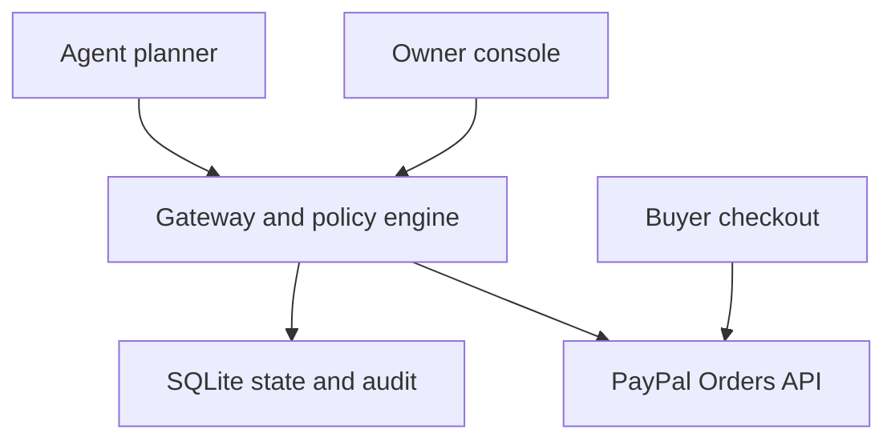
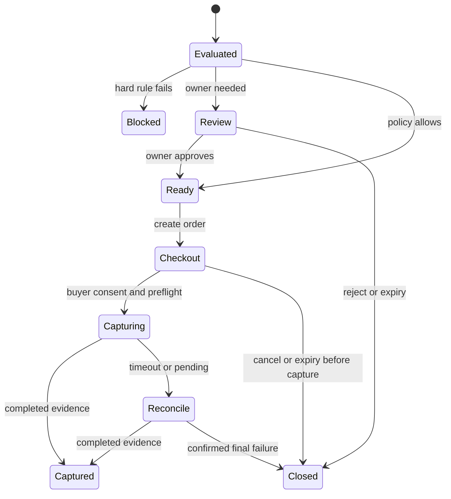

# PayPal hackathon: decision, PRD and implementation plan

**Selected project:** Mandate Lite — controlled checkout for an AI purchasing agent  
**Version:** 1.0 · 10 November 2026 · All schedule times use IST  
**Planning verdict:** feasible as a deliberately narrow sandbox prototype, conditional on the first integration gate.  
**Validation completed:** official-document review, scope and threat-model review, 40 executable design-model checks, six colour-contrast calculations.  
**Validation pending:** authenticated PayPal sandbox execution, real model evaluation, completed application tests and user interviews. This document is a plan, not a claim that the application already exists.

## 1. Decision in one minute

Build **a reduced version of idea #1, Mandate**, rather than its original infrastructure platform.

A small team's purchasing agent proposes a basket at a participating merchant. The server checks an explicit spending mandate. An allowed request proceeds to buyer checkout; a medium-value request needs the owner's approval first; a prohibited request never reaches order creation. The receipt connects the basket, policy result, owner decision and PayPal capture.

**Pitch:** “Let an agent prepare purchases. Keep spending permission explicit, enforce it before payment, and show what happened afterward.”

This preserves the strongest demonstration from the original proposal without depending on delegated wallet access, fund holds, model-based fraud detection or a custom MCP server.

**Why this choice:** a standard PayPal checkout is a smaller integration dependency than dispute workflows, universal storefront extraction or cross-user Venmo requests. The additional product is a deterministic permission boundary around that checkout. Its benefit is visible in a short demo, and the planner gives AI a real task: translating a contextual purchasing need into a grounded basket.

**Important scope boundary:** this gateway governs purchases through an integrated merchant checkout. It cannot stop an agent that independently holds usable payment credentials from buying elsewhere. The merchant integration is part of the enforcement boundary. Do not pitch this as a universal PayPal wallet firewall.

**Effort assumption:** one developer comfortable with TypeScript/Express/React, or two teammates sharing implementation and presentation. Budget **18–24 focused engineering hours plus 6–8 hours for integration buffer, documentation and submission**. These are planning estimates, not measured delivery times. A beginner team should expect longer.

The verified deadline is **12 November 2026, noon PST**, which converts to **13 November, 1:30 a.m. IST**. Use **12 November, 8:00 p.m. IST** as the internal submission deadline. [S1]

If fewer than 16 engineering hours are genuinely available, reduce to a fixed published mandate and one-request spending caps; remove the cumulative-budget claim and configure no monthly allowance. Keep real AI planning, owner approval and real PayPal capture. Do not attempt the full original ideas in that time.

## 2. Comparison of all seven ideas

The estimates below describe credible narrow prototypes, not production services. They include core engineering but exclude the shared 6–8-hour submission allowance. They are judgments about dependencies and work, not statistics about teams or prize odds.

| Idea | Estimated engineering | Principal difficulty | Verdict for this window |
| --- | ---: | --- | --- |
| #1 Full Mandate | 45–80 h | Delegation, authorizations, Vault, policy interpretation, MCP and reconciliation | Too much. Retain its permission mechanism and cut the infrastructure. |
| #2 AgentReady | 45–80 h | Crawling does not grant inventory, fulfilment or merchant-payment integration rights | Reject. A convincing catalog demo is much easier than a valid transaction adapter. |
| #3 Settle | 35–60 h | Accessible dispute cases, evidence sources and safe submission | Reject. Too many integration gates; outcome claims require real evidence. |
| #4 Full Runway | 35–55 h | Cash/outflow completeness, uncertain forecasts and collection actions | Reject full scope. An invoice-action copilot is the backup. |
| #4 Invoice-action slice | 14–22 h | Differentiation from native reminders; custom messaging adds integration | Fastest conventional CRUD option, but less compelling under current API constraints. |
| #5 Guardian | 40–70 h | Access to payment context, false alarms, valid intervention mechanism | Reject. An Orders authorization is not a generic hold on any outgoing transfer. |
| #6 Retain | 30–50 h | Billing lifecycle, retry controls, data needed to learn timing | Reject. Avoid claiming learned optimal retries from synthetic data. |
| #7 Split | 35–60 h | Permission to create and track person-to-person Venmo requests | Reject until an accessible official API is established; merchant Venmo checkout does not establish this. |
| **#1 Mandate Lite** | **18–24 h** | **Correct payment state, permission checks and conservative retry handling** | **Selected. Best balance of buildability and a distinctive working demonstration.** |

### Transparent decision model

Scores are 1–5, with 5 better. Weights reflect this deadline: speed 30%, accessible API path 25%, demo clarity 20%, root-problem coverage 15%, meaningful AI 10%.

| Candidate | Speed | API path | Demo | Root coverage | AI | Weighted score |
| --- | ---: | ---: | ---: | ---: | ---: | ---: |
| Full Mandate | 1 | 2 | 5 | 5 | 4 | 2.95 |
| AgentReady | 1 | 2 | 4 | 4 | 4 | 2.60 |
| Settle | 2 | 2 | 4 | 4 | 4 | 2.90 |
| Full Runway | 2 | 3 | 4 | 3 | 3 | 2.90 |
| Invoice-action slice | 5 | 4 | 3 | 3 | 3 | 3.85 |
| Guardian | 1 | 2 | 4 | 3 | 4 | 2.45 |
| Retain | 2 | 2 | 3 | 3 | 3 | 2.45 |
| Split | 2 | 1 | 4 | 3 | 3 | 2.40 |
| **Mandate Lite** | **4** | **4** | **5** | **4** | **4** | **4.20** |

Sensitivity: raising speed's weight to 50% and reducing the other weights proportionally reverses the narrow lead: invoice slice 4.18, Mandate Lite 4.14. Existing working invoice integration can also reverse the decision. No such asset is assumed here. Do not treat a 0.35-point gap under the original weights as scientific certainty; Mandate Lite is the better balanced choice, while the invoice slice is the speed-first choice.

### Corrections to the supplied research

| Supplied assumption | Verified correction or unresolved issue | Planning consequence |
| --- | --- | --- |
| Create an `AUTHORIZE` order to place a hold | Buyer approval precedes the authorization operation. Order creation alone is insufficient. [S2] | Use ordinary `CAPTURE` checkout after internal permission. No pre-approval fund hold. |
| PayPal's merchant client credentials let any agent spend a user's wallet | Orders APIs are merchant/partner APIs; payer participation is a separate step. [S3] | Merchant-side integration, explicit buyer checkout, no unattended wallet-spending claim. |
| AI-written PayPal reminder copy is directly deliverable | Current reminder reference says user-provided subject and note are ignored. It also documents a daily reminder limit. [S7] | Runway's personalized reminder demo needs a separate channel or a different AI role. |
| AG Grid table features automatically make a strong sponsor entry | Sponsor brief emphasizes AG Studio, customization and its agent framework. Advanced grid capabilities also have licence differences. [S8, S9] | Use Community for a useful audit grid; do not expand scope merely to chase the prize. |
| More sponsor slots imply a known best expected value | Entrant counts and quality distributions are unknown | No prize-probability estimate; choose based on completed product quality. |
| A webhook simulator proves a real payment | Simulator payloads do not represent real transactions. [S10] | Record actual sandbox capture IDs and verified provider state. |
| A hash-chained database is immutable | A privileged administrator can rewrite data and recompute a chain | Call the MVP history an audit trail. Do not claim immutable evidence. |

## 3. Problem, audience and root cause

### Initial audience

A small business owner testing an office purchasing agent with **one cooperating office-supply merchant**. The owner wants useful purchasing assistance without letting model output become payment authority.

Example persona, deliberately hypothetical: Priya runs a six-person design studio. An agent can select supplies for new hires. Priya permits small purchases, reviews larger ones and forbids certain categories. She needs to see why a request was permitted and whether payment actually completed.

This audience and pain are **product hypotheses**, not validated customer findings. Before making market-size or savings claims, speak with at least two owners and one developer integrating an agent into checkout. If time prevents that, label this as a developer prototype and avoid claiming adoption or recovered money.

### Root-cause analysis

| Root cause within our integration | Mechanism that addresses it | What the prototype can establish |
| --- | --- | --- |
| Purchasing intent and permission are conflated | Separate planner output from server-controlled rules | A model request cannot approve itself. |
| Mutable client/model data influences price or category | Resolve SKUs, attributes and all prices on the server | Changing a browser amount does not change the payable basket. |
| Parallel requests each see the same remaining budget | Atomic cumulative-budget reservations | Accepted requests cannot collectively overbook the mandate's available budget. |
| An owner approves one basket but another is paid | Bind approval to a canonical basket hash and fixed total | Any material alteration invalidates approval. |
| Retries create uncertainty or duplicate effects | Durable operation IDs, guarded transitions and provider reconciliation | A repeat request resumes the same operation instead of starting another charge. |
| Permission history and payment history are disconnected | One request ID links policy version, actor decisions, order and capture | The owner can reconstruct this purchase's lifecycle. |

Writing “please follow the budget” in a prompt cannot enforce these properties. A dashboard alert after capture is too late to prevent the purchase. The server must control the create/capture routes, and the agent must lack an alternative payment credential in this deployment.

### Explicit limits

This does not solve all agentic commerce trust. It does not establish legal authorization, detect every malicious owner, verify merchant integrity, guarantee fulfilment, prevent spending at external merchants, or guarantee refunds. Existing payment consent remains necessary. A gateway compromise or merchant administrator bypass is outside the MVP's assurance claim.

### Why internal approval still matters when PayPal asks the buyer

Business spending permission and payment consent answer different questions. A manager can approve an expense while an employee is the person consenting to pay at checkout. Policy checks can also block a request before that checkout exists. The MVP may demonstrate both human roles using one operator, but must not pretend that this eliminates human checkout work.

If the intended customer is only an individual buying from one store with their own wallet, the second approval has limited additional value; that is a weaker use case. The initial product hypothesis is a team or developer integrating controlled purchasing, where the policy owner and payment participant have distinct responsibilities. Genuine role separation and merchant willingness to integrate require validation after the prototype. If interviews reject that arrangement, reconsider the product rather than adding more dashboard features.

## 4. Product outcome and scope

**Primary outcome:** demonstrate that an AI-planned purchase can proceed, require review or be stopped according to a published mandate, with payment verified independently of the model.

### P0: must ship

1. One sandbox merchant, one owner, one agent and USD only.
2. A small first-party catalog, approximately 12–20 items, with fixed prices and categories.
3. An LLM planner that handles contextual requests and produces only catalog SKU/quantity selections or a clarification.
4. One owner-created mandate, locked after activation; revocation remains available.
5. Server-side basket validation, deterministic rules and cumulative-budget reservations.
6. Allow/review/block outcomes with rule-specific explanations.
7. Owner review bound to the exact basket; approve or reject.
8. Real PayPal sandbox create → buyer consent → capture.
9. An audit view joining request, policy decision, human decision, order and capture.
10. Durable retry/reconciliation behaviour, restart recovery and meaningful error states.

### P1: only after P0 acceptance

- AG Grid Community audit filtering and CSV export; budget 45–60 minutes if familiar.
- A read-only replay using clearly labelled fixtures, alongside live sandbox mode.
- A small downloadable JSON audit record.

### Excluded until after submission

Custom MCP server, PayPal MCP dependency, Vault, unattended buyer payment, authorization holds, disputes/refunds UI, multi-merchant onboarding, multi-currency/FX, monthly automatic resets, dynamic shipping/tax, recurring purchases, push notifications, live risk scores, trained anomaly models, blockchain, private model reasoning traces, AG Studio, Redis, microservices and a native mobile application.

For physical demo products use fixed, clearly disclosed pickup/zero shipping and explicit zero tax as sandbox fixtures. Do not imply that zero tax is a general business rule. Price, fulfillment mode and all charges must be known before approval. A real store would need its own tax and delivery integration.

## 5. Functional requirements and acceptance criteria

| ID | Requirement | Acceptance criterion |
| --- | --- | --- |
| FR-01 | Activate a mandate | Owner enters budget, hard cap, approval threshold, categories and expiry. Invalid thresholds or empty categories are rejected. The saved version is immutable. |
| FR-02 | Plan a basket | A real model maps a multi-constraint request to known catalog SKUs and integer quantities. Unknown products or ambiguous requirements produce clarification, not an invented item. |
| FR-03 | Validate basket | Server recomputes each price, category and the gross total; rejects unknown fields, SKUs, invalid quantities and non-USD requests. Duplicate SKU lines are merged before limits are checked. |
| FR-04 | Evaluate permission | Same canonical input and mandate produce the same decision and machine-readable rule IDs. Policy failures take precedence over review. |
| FR-05 | Enforce cumulative budget | In one database transaction, count spent plus active reservations plus this basket. Concurrent submissions cannot exceed the cap. |
| FR-06 | Review | Only the owner session can approve/reject a review request. Approval references request ID, basket hash, total, mandate version and expiry. No hard-rule override. |
| FR-07 | Create checkout | Only an allowed or owner-approved unexpired request can create one PayPal order. Agent credentials cannot invoke payment routes directly. |
| FR-08 | Obtain buyer consent | The UI visibly hands off to PayPal. Internal approval never appears as completed payment. Buyer cancellation remains non-paid. |
| FR-09 | Capture | A server-side preflight checks permission, reservation, request ownership, saved order ID and provider amount/currency/payee. Capture success requires the capture's `COMPLETED` status. |
| FR-10 | Handle uncertainty | Timeout/pending state retains the reservation and displays “Checking payment.” No new order or fresh capture key is created to resolve uncertainty. |
| FR-11 | Reconcile | An authenticated refresh reads the same saved PayPal order and repairs local state after a callback failure or restart. Duplicate completion does not count spend twice. |
| FR-12 | Expire/revoke | A 15-minute internal request TTL and mandate revocation block new capture attempts. In-flight/uncertain captures remain reserved until reconciled. |
| FR-13 | Audit | Each request shows basket, mandate version, rule results, owner actor/time if needed, operation IDs, provider order/capture IDs and final/uncertain status. |
| FR-14 | Protect access | Agent key cannot approve, activate/revoke mandate or capture. Owner routes require an authenticated session plus CSRF protection. IDs alone grant no permission. |
| FR-15 | Recover consistently | Restart with the same database preserves budget and unresolved operations. A new browser tab cannot create a duplicate order for the same request. |

Non-functional targets, to measure rather than advertise in advance: deterministic decision under 100 ms locally excluding external APIs; planner response target under 8 seconds; visible loading/error states; no secrets in client assets, exports or logs; keyboard-operable actions; no fake payment success after errors.

## 6. Policy contract and worked demonstration

### Default demo mandate

```json
{
  "id": "studio-pilot",
  "version": 1,
  "currency": "USD",
  "budgetCents": 40000,
  "maxOrderCents": 20000,
  "ownerReviewAboveCents": 15000,
  "allowedCategories": ["kitchen", "office", "gifts"],
  "requestTtlSeconds": 900,
  "active": true
}
```

Persist an explicit `expiresAt` at activation. The $400 is a **bounded pilot mandate budget**, not a monthly recurring allowance. The cap applies to the entire payable basket, not each item separately. The owner cannot edit the active mandate during the pilot; revocation closes it. Creating a replacement mandate is a later administration workflow, not a way for the agent to reset the budget.

### Rule order

1. Validate authenticated agent/workspace, idempotency key and strict schema.
2. Resolve and merge server catalog items; freeze prices and quantities.
3. Reject invalid, inactive/expired mandate, unsupported currency and forbidden categories.
4. Reject gross basket total above $200.
5. Atomically reject if `spent + reserved + gross > 40000 cents`; otherwise reserve gross.
6. If gross exceeds $150, require owner review. Otherwise allow checkout preparation.

Equality is intentional: $150 is allowed without additional owner review; $150.01 requires review; $200 can be reviewed; $200.01 is blocked. Review never overrides a category, hard cap or cumulative-budget failure.

| Request | Trusted basket total | Expected result | PayPal activity |
| --- | ---: | --- | --- |
| Office coffee restock | $18 | Policy allowed | Buyer checkout; capture only after consent |
| Espresso machine | $900 | Blocked by hard cap/category | No order created |
| Team gift basket | $180 | Owner review | No order until approved; then buyer checkout |

After coffee and gift complete, committed spend is $198 and remaining budget is $202. “Policy allowed” means the additional business check passed; it does not mean the model paid autonomously.

### AI input/output boundary

Input: user need, catalog attributes, current policy summary and previous clarification if any. A bounded example is: “We have six new starters. Pick reusable desk supplies under $80; avoid electrical items.” This requires interpreting needs, quantities and attributes, rather than matching a fixed command.

Output schema:

```ts
type Plan =
  | { kind: "basket"; items: { sku: string; quantity: number }[];
      userSummary: string; preferenceEvidence: string[] }
  | { kind: "clarification"; question: string };
```

Use strict schema validation. At most 10 output lines, quantity 1–20 per SKU and a bounded input length. The model cannot choose amount, currency, merchant identity, category, policy result or owner identity. Treat catalog descriptions and user text as untrusted data. Store a short user-facing summary, structured output, provider/model identifier and prompt-template version; do not request or publish hidden chain-of-thought.

If the model times out, retry once before any payment action. If unavailable, show the failure and optionally offer manual catalog selection clearly labelled as a fallback. Manual selection does not count as demonstrating meaningful AI.

## 7. Architecture and payment sequence

### Implementation choice

Use **React + Vite + TypeScript**, **Node.js + Express + TypeScript**, schema validation, and **SQLite** on persistent local storage. Express serves the built frontend in production. Choose supported package versions when scaffolding and commit a lockfile; this PRD does not guess current package versions.

This matches a familiar React/Express skill base and avoids the Expo packaging cycle. Keep one deployable process and one database. No Redux is needed for three screens; server state and a small query/cache layer are enough.



The browser and planner never receive the merchant client secret or OAuth access token. The agent API key authorizes proposal submission only. It is a different credential from owner login. The demo may show both roles in separate tabs, but a role-switch control must not grant server permissions.

### Exact integration sequence

1. Server obtains an access token through `POST /v1/oauth2/token` using sandbox merchant credentials. Cache until shortly before expiry; never log the token.
2. The agent submits its intent with an idempotency key. The gateway freezes the basket, evaluates policy and reserves budget.
3. For review, the owner explicitly approves the frozen basket or rejects it. There is no PayPal fund hold during this interval.
4. The server persists a create-operation UUID, claims a `CREATING_ORDER` state and calls `POST /v2/checkout/orders` with `intent: "CAPTURE"`. [S4]
5. Persist the returned order ID. Redirect the buyer using the approval/payer-action link appropriate to the tested response. Do not construct a payment URL from untrusted text.
6. On return, verify the session-bound request and saved order ID. The callback URL/query token alone is not payment evidence. `GET /v2/checkout/orders/{id}` checks provider state and trusted amount/currency/payee. [S6]
7. Inside a database transaction, recheck mandate validity, immutable approval binding, reservation and request TTL; claim `CAPTURING` and persist a separate capture-operation UUID. Commit, then make the external call.
8. Call `POST /v2/checkout/orders/{id}/capture` using that stable capture UUID in `PayPal-Request-Id`. Distinct API operations use distinct keys. [S5, S11]
9. Verify the returned capture's ID, gross amount, currency and `COMPLETED` status. Atomically move reserved money to spent and append the receipt. Pending/uncertain results remain reserved and are reconciled through a provider read.

**Linearization rule:** once step 7 commits `CAPTURING`, that attempt is in flight. Later revocation cannot guarantee stopping it; it prevents future attempts. The UI must disclose an in-flight request rather than promise retroactive cancellation.

Illustrative minimal create body; verify it with the actual sandbox account during Gate G1:

```json
{
  "intent": "CAPTURE",
  "purchase_units": [{
    "reference_id": "saved-request-id",
    "custom_id": "saved-request-id",
    "amount": { "currency_code": "USD", "value": "18.00" }
  }],
  "payment_source": {
    "paypal": {
      "experience_context": {
        "user_action": "PAY_NOW",
        "return_url": "https://YOUR_APP/checkout/return",
        "cancel_url": "https://YOUR_APP/checkout/cancel"
      }
    }
  }
}
```

The fixed sandbox merchant is the payee. For the optional single-buyer pilot restriction, provision the expected buyer account ID and verify the returned payer identity against it before capture. Do not infer that the owner session is automatically the same identity as the PayPal payer. If identity mapping is not implemented, describe the owner as expense approver and PayPal participant as the consenting payer, without claiming wallet delegation.

### Minimal application endpoints

| Endpoint | Authority | Responsibility |
| --- | --- | --- |
| `POST /api/session` | Owner login | Create secure owner session |
| `POST /api/mandate` | Owner | One-time activation with validated limits |
| `POST /api/mandate/revoke` | Owner | Stop future payment attempts |
| `POST /api/plans` | Authenticated agent/demo planner | Call real model; return validated selection |
| `POST /api/intents` | Agent | Freeze/evaluate/reserve; idempotent on request key |
| `GET /api/intents/:id` | Authorized actor | Read scoped status |
| `POST /api/intents/:id/decision` | Owner | Approve/reject exact basket hash |
| `POST /api/intents/:id/checkout` | Owner/payer session | Create or reuse the saved order |
| `POST /api/intents/:id/capture` | Owner/payer session | Validate binding and attempt capture once |
| `POST /api/intents/:id/reconcile` | Owner | Read provider state; repair local state |
| `GET /api/audit` | Owner | Read filtered audit data |

Use same-origin requests, secure HTTP-only cookies, CSRF checks and rate limits. The PayPal return route loads a confirmation screen; a protected POST performs the mutation. A GET redirect must not directly charge a user.

## 8. Data, invariants and failure behaviour

### Minimum persisted entities

| Entity | Essential fields |
| --- | --- |
| Workspace/owner | ID, owner login hash, demo flag |
| Agent | ID, workspace ID, hashed API key, active flag |
| Catalog item | SKU, category, fixed gross unit price in cents, attributes, version |
| Mandate | ID, workspace ID, immutable version, budget/cap/threshold, categories, expiry, revoked timestamp |
| Purchase request | ID, agent ID, idempotency key, canonical basket/hash, amount, mandate version, decision, state, expiry |
| Owner decision | Request ID, basket hash, actor ID, decision, timestamp |
| Reservation | Unique request ID, amount, active/committed/released state |
| Payment operation | Unique request+operation type, stable UUID, order ID, capture ID, state, sanitized error |
| Audit event | ID, request ID, actor, event type, rule results, timestamp, sanitized provider reference |

Use foreign keys and uniqueness constraints. Store integer cents, not binary floating-point totals. Keep monetary calculations server-side. Audit data is append-only through application routes; it is not tamper-proof against database administrators.

### Invariants and proof sketches

**I1 — Budget:** `committedSpend + activeReservations <= budget`.

In a serialized write transaction, a new reservation is permitted only if adding its gross keeps the inequality true. Capture transfers an amount from reservations to committed spend, leaving the sum unchanged. Safe release decreases it. Therefore these operations preserve the inequality from a valid initial state. This proof assumes every payment route uses these transitions and the database is authoritative; it is not a proof against administrator edits or external spending.

**I2 — Approval binding:** approval is valid only for the saved `(requestId, basketHash, gross, mandateVersion, expiry)` tuple. The payment adapter builds its order from that frozen tuple. Changing an item or price requires a new intent and approval. A client-supplied “approved” flag is never read as authority.

**I3 — Duplicate protection:** a request key is unique within agent/workspace; reusing it with another canonical body returns a conflict. Create/capture operations have persisted stable UUIDs and guarded state transitions. A provider timeout cannot trigger a fresh operation. This reduces duplicate effects within the documented API idempotency window; after that window, unresolved operations require inspection/reconciliation, not blind retry. [S11]

**I4 — Payment truth:** success requires authenticated provider evidence of the expected completed capture. Neither model text, a browser redirect nor a fixture can mark the live ledger paid.

### Local states



`CREATING_ORDER` is also persisted operationally. A timeout there is uncertain even if no payment occurred: preserve its operation key and resolve the create outcome before starting another order. The diagram compresses that adapter substate for readability.

### Failure decisions

| Condition | Required behaviour |
| --- | --- |
| Unknown SKU or malformed model output | No reservation, no PayPal call; show clarification/error |
| Browser alters a price/category | Ignore/reject client financial fields; canonical server basket controls |
| Owner rejects review | Release once; no order |
| Expiry before any capture attempt | Atomically close request and release reservation; later callbacks cannot capture |
| Buyer cancels | Close only if capture has not begun; never release an in-flight attempt |
| Create timeout | Keep operation/reservation; bounded same-key recovery, then manual inspection if unresolved |
| Capture timeout or pending | Retain reservation; display uncertainty; read provider state |
| HTTP 200/201 with non-completed capture | Do not show paid |
| Double click/two tabs | Return current operation or conflict; one guarded transition wins |
| Revocation during buyer checkout | Preflight blocks capture if not already claimed |
| Application crashes after provider capture | Reconciliation reads saved order and commits spend exactly once |
| Provider unavailable | Preserve state and reservation; show retryable verification error |

Lazy expiry runs on authenticated reads/actions and once on process startup. It may release only requests with no in-flight/uncertain external operation. Do not add a scheduler merely to clean up demo rows.

Keep database transactions short: claim operation state and commit before an external request. Do not hold a SQLite write lock while waiting for PayPal or the model.

## 9. Design decisions, evidence, pros and cons

Evidence labels: **D** = official documentation; **L** = logical argument; **M** = executed model check; **H** = hypothesis requiring user validation. A design choice can be justified without being universally optimal.

| Decision | Why it fits this task and supporting evidence | Benefit | Cost / condition under which to revisit |
| --- | --- | --- | --- |
| Permission before ordinary checkout | Orders requires payer involvement; separate internal approval is an application rule. D: S2–S6 | Fewer payment states; no delegation assumption | Buyer still acts at PayPal; revisit only with proven delegated-payment access |
| Structured mandate, no NL policy compiler | Rule semantics and thresholds stay explicit. L + M: boundary checks | Owner sees exactly what is enforced | Less conversational setup; add compiler only with schema preview and owner confirmation |
| LLM chooses catalog selections; rules decide permission | Separates useful interpretation from authority. L + H | Model can assist without choosing trusted totals | Catalog attributes must be adequate; evaluate multi-constraint tasks |
| Server catalog and frozen basket | Untrusted clients cannot define price/category. L + M: aggregate validation | Prevents basic price/category manipulation | No live third-party inventory; merchant adapter needed later |
| Atomic budget reservation | Independent read/check/write permits oversubscription. L + M: concurrent SQLite test | Correct cumulative budget in pilot | Requires careful expiry/uncertainty handling |
| One process and SQLite | Serial transactions suit a low-volume single-instance demo. M: transaction model | Fast setup, durable local run | Not multi-instance architecture; persistent disk needed when hosted |
| Provider reads instead of mandatory webhooks | Capture response and order read support the central demo. D: S5–S6 | Local setup avoids webhook registration and public listener dependency | Dashboard refresh discovers delayed changes; add verified webhooks for production responsiveness |
| Separate policy and payment statuses | Different systems establish different facts. L | Clear consent and failure states | More explicit UI labels; test comprehension |
| App audit trail, no immutable-ledger claim | Administrator can alter a local DB. L | Honest, useful evidence | Add externally anchored retention only if the trust model demands it |
| Web UI and minimal state management | Three views, one server source of truth. H | Avoids mobile packaging and duplicate state logic | No native push; revisit after actual usage |
| AG Grid Community only if time allows | Free core grid; advanced features differ. D: S9 | Useful filters without licence work | A basic grid alone is weak sponsor differentiation; do not overstate competitiveness |

The logical proofs rely on correct implementation. The model tests below exercise selected invariants. Neither proves the shipped application secure or establishes product-market fit.

## 10. UI/UX specification

**Personality:** calm operations tool; legible, restrained and explicit about money. Avoid a chat-only interface because the owner must scan decisions and reconcile states.

### Three views

| View | Layout and primary action | Required states |
| --- | --- | --- |
| Mandate setup | Single form plus plain-language policy preview; “Activate mandate” | Invalid limits, active/locked, expired/revoked |
| Agent purchase desk | Need input and live planner result; canonical basket beside rule results and checkout status | Planning, clarification, policy allowed, review needed, blocked, awaiting buyer, verifying, paid, failed |
| Owner operations | Budget summary, review queue and audit list; request detail opens a drawer | Empty queue, review, rejection, stale/expired request, in-flight capture, unresolved payment |

At 1280 px, use a central maximum-width content area, 240 px navigation and a two-column purchase desk. At 390 px, collapse navigation and stack basket/rules/actions; use request cards instead of forcing a wide grid. Keep amount and status visible above the primary action.

### Components and copy

- Budget strip: **spent / reserved / available**, with amounts rather than only a progress bar.
- Outcome card: icon + text + rule ID. Example: “Blocked — $900 exceeds the $200 order limit.”
- Review card: exact basket, $180 total, policy version, expiry and clear Approve/Reject buttons.
- Checkout action: “Continue to PayPal.” After internal approval: “Owner approved. Buyer consent still needed.”
- Receipt: “Sandbox payment completed,” with order/capture IDs and the trusted total.
- Uncertainty: “Checking payment. Your budget reservation remains in place.” Never a green success toast after a timeout.
- Audit drawer: timestamps, actors, rule checks and provider references; no fabricated model reasoning.

### Tokens and measured contrast

Use 16 px base type, 1.5 body line height, an 8 px spacing rhythm, 12 px card radius, visible focus outlines and at least 44 px action targets. Use text and icons as well as colour. Financial amounts use tabular numerals.

| Role | Foreground / background | Calculated contrast |
| --- | --- | ---: |
| Primary text | `#14213D` / `#FFFFFF` | 15.97:1 |
| Secondary text | `#536179` / `#FFFFFF` | 6.26:1 |
| Main action | `#FFFFFF` / `#2563EB` | 5.17:1 |
| Allowed/paid label | `#047857` / `#FFFFFF` | 5.48:1 |
| Review label | `#92400E` / `#FFFFFF` | 7.09:1 |
| Blocked label | `#B91C1C` / `#FFFFFF` | 6.47:1 |

These six pairs were calculated during planning and exceed a 4.5:1 text target. This is not a full accessibility audit. If tinted badge backgrounds replace white, recalculate those exact pairs.

Motion: 120–180 ms opacity and position changes for cards/drawers; no celebratory payment animation that masks pending state. Respect reduced motion. Prevent duplicate submissions with both UI busy states and server enforcement.

## 11. Implementation work breakdown

Timeboxes are focused engineering hours. Finish each exit condition before proceeding. No sponsor integration can displace a P0 exit condition.

| Phase | Hours | Concrete work | Exit condition |
| --- | ---: | --- | --- |
| G1: integration spike | 1.5–2 | Sandbox seller/buyer; OAuth; create, buyer approve, capture, read order; real model schema response | Save one real sandbox order/capture reference and one actual model result. Cancel path also observed. |
| Foundation | 1–1.5 | React/Express TS, schema types, SQLite migration, owner/agent credential separation | Protected endpoints and persisted seed catalog run locally |
| Policy and budget | 3–4 | Immutable mandate, canonical basket/hash, rule evaluation, atomic reserve/release, TTL | Boundary, concurrency and aggregate-basket tests pass |
| AI purchasing | 1.5–2 | Catalog-context prompt, strict output parsing, clarification, actual model calls | At least five contextual prompts manually reviewed against catalog and user need |
| Approval and payment lifecycle | 4–5 | Owner binding, order/capture operation records, provider preflight, retry/reconcile, restart path | All three demo branches plus timeout/restart behaviour work |
| UI completion | 3–4 | Three views, accessible states, budget and receipt details | Clean end-to-end run at desktop and 390 px |
| Integration QA | 2–3 | Real sandbox reruns, tamper tests, fresh setup, production build | P0 acceptance checklist passes with saved evidence |
| **Engineering total** | **16–21.5 base** | **Round up for ordinary integration friction** | **Plan for 18–24 hours** |

Reserve a further **6–8 hours**: 1–2 for packaging/hosting decision, 1–2 for README and submission text, and 3–4 for recording, editing and final verification. This buffer is part of the commitment, not optional spare time.

### Calendar plan

| Date | Milestone |
| --- | --- |
| 10 Nov | G1 by the first two focused hours. Then foundation, policy/budget and a minimal planner. Obtain the first real checkout recording early. |
| 11 Nov | Approval/payment state machine, reconciliation and UI. Freeze P0 features at night. |
| 12 Nov, morning | Acceptance, clean setup and build; fix only blockers. Optional grid only if all P0 tests pass. |
| 12 Nov, afternoon | Record demo, write README and submission, validate links and test access. |
| 12 Nov, 8 p.m. | Submit complete entry; preserve remaining time for upload/form problems. |

Two-person team: backend/payments owner and frontend/planner/presentation owner; agree request/response schemas first. Do not split into many services to create parallel work.

### Hard gates and scope cuts

- **G1 fails after two focused hours:** stop adding features. Inspect account restrictions, API errors and credentials. Every proposed idea still needs some working PayPal surface; changing to another untested API is not automatically faster.
- **Orders remain unavailable but Invoicing is already verified:** switch to the narrow invoice-action backup: import genuine invoice state → explain deterministic overdue priorities with AI → human triggers PayPal's standard reminder → refresh status. Do not claim delivery of custom AI copy through that endpoint. Re-plan the remaining hours before switching.
- **No working capture by the end of day one:** remove cumulative budget only if necessary and explicitly remove its product claim. Keep one-order limits, owner approval and payment truth.
- **Model unavailable:** do not call a scripted basket an AI result. Restore a real model connection or reconsider whether the entry meets the stated theme.
- **Hosting friction:** deliver the reproducible local app and setup instructions; hosting is not required. [S1]
- **Late feature pressure:** cut analytics, export and sponsor work before state validation, audit linkage or recording time.

## 12. Validation performed on this plan

### Documentary validation

Official sources were reviewed on 10 November 2026. They establish the availability and semantics of ordinary merchant checkout, the separate payer step, Orders reads/capture, idempotency guidance, invoice reminder constraints and sponsor/licensing/deployment caveats. They do **not** establish that your sandbox account has access or that our chosen payload has already succeeded there.

### Executed design-model validation

An isolated Python design model was executed during preparation. It used integer-money rules, a capture preflight predicate, conservative reconciliation outcomes and actual SQLite transactions from concurrent threads. **40 assertions passed; zero failed. No PayPal or LLM call was made by that model.** It is not application code or a full end-to-end simulator.

| Group | Checks executed | Count |
| --- | --- | ---: |
| Decision and schema boundaries | Coffee, gift, machine, threshold equality/+cent, hard-cap equality/+cent, budget equality/+cent, reservations, category, currency, zero/negative/float amount, zero/fraction/boolean/excess quantity, unknown SKU, revoked mandate | 21 |
| Monetary aggregation | Exact decimal-to-cents multiplication; combined basket above hard cap | 2 |
| Capture preflight | Normal path; rejection, revocation, amount mismatch, absent reservation, expiry, already captured and unresolved prior attempt | 8 |
| Reconciliation | Completed commits spend; pending/timeout retain reservation; confirmed decline releases | 4 |
| SQLite/idempotency model | Concurrent reservations, remaining-budget check, same-key replay, changed-body conflict, repeated terminal transition | 5 |
| **Total** | **All passed** | **40** |

Concurrency example: three simultaneous $180 reservations compete for a $400 budget. Exactly two reserve and one is blocked; remaining available budget is $40. That is stronger evidence for this transaction pattern than three sequential UI clicks. The production implementation must still reproduce it.

The model's limits: it does not test HTTP route permissions, real provider races, model reliability, actual order payloads, cryptographic sessions or browser checkout. Those remain acceptance tasks below.

### Review findings resolved before delivery

1. Removed the incorrect equation of `AUTHORIZE` order creation and a funds hold.
2. Removed the implication that merchant OAuth credentials permit unattended buyer-wallet spending.
3. Bound owner approval to frozen basket data; disallowed approval overriding hard failures.
4. Made reservations account for concurrent pending requests and uncertain captures.
5. Defined an in-flight revocation boundary instead of promising impossible retroactive cancellation.
6. Avoided releasing funds on a timeout, callback cancel or process restart without checking operation state.
7. Replaced “immutable ledger” and “reasoning trace” claims with a scoped audit record.
8. Kept hosting and licensed sponsor features outside the critical path.

**Plan status:** documentary and selected-invariant validation passed. Integration readiness is conditional. Treat G1 as a mandatory build gate, not as a box already checked.

## 13. Required application validation before submission

| Test | Setup/action | Required evidence |
| --- | --- | --- |
| Real AI | Five contextual prompts, including an ambiguous request and conflicting preferences | Actual model identifier/output; no unknown SKUs; appropriate clarification |
| Allowed purchase | $18 basket; buyer completes sandbox consent | Correct provider order/capture, completed receipt and spent +$18 |
| Block | $900 machine | Recorded rule failure; PayPal adapter call count remains zero |
| Review | $180 gift; agent tries to approve, then owner approves | Agent denied; owner approval recorded; checkout only after owner decision |
| Reject | Owner rejects another review request | Reservation released exactly once, no order |
| Tamper | Change client total, SKU category, approved flag, request/order ID | Trusted data prevails; unauthorized or mismatched request fails |
| Aggregate attack | Multiple permitted items form an excessive basket | Basket-level cap enforced |
| Concurrent budget | Three concurrent $180 requests with $400 available | At most two active reservations |
| Retry | Duplicate create/capture calls and callbacks | Same saved operation/order; no extra captured amount |
| Timeout | Drop capture response after provider accepts it | Checking state; reservation retained; reconcile to completed once |
| Pending/decline | Adapter-controlled fixture in isolated test mode | Pending never appears paid; confirmed failure releases safely |
| Revoke/expire | Revoke or expire before capture claim | Capture blocked; in-flight exception displayed accurately |
| Restart | Restart after operation persisted, including after provider success | Same IDs and amounts; no budget reset; reconciled receipt |
| Fresh setup | Teammate follows README from a clean directory | App runs with documented prerequisites and sandbox keys |
| UI | Desktop, 390 px, keyboard, reduced motion | Actions usable and states readable |

Use unit tests for financial rules; integration tests for transactional transitions and credential separation; an HTTP stub for deterministic provider failures; and one real browser checkout for each meaningful payment branch. Keep fixtures visibly separate from live evidence.

### Honest impact measurements

- Report the number of policy scenarios exercised and the failures prevented **in the test set**.
- Measure model-to-basket completion time and manual corrections across the five prompts.
- Ask two users to explain the difference between policy allowance and payment completion.
- Report no annual savings, prevented fraud amount, accuracy percentage or customer adoption without supporting data.

## 14. Deployment, cost and judge access

Default delivery is a locally runnable single application with a lockfile, migration/seed command and environment-variable template. Document required Node version from the actual build. The seed creates products and a fresh empty ledger, never fake completed PayPal payments in live mode. Use `npm ci`, documented environment setup and one start command after build.

If hosting on Render, use one paid web service with a persistent disk and put SQLite under that mount; ephemeral filesystem storage loses state across restarts/deploys. [S12] This is a small-demo choice, not a scale architecture. If disk/service cost or access is a blocker, keep the local run path rather than adding a second database backend under deadline pressure.

PayPal sandbox money is test money. Model API calls and hosting may incur actual charges. Use existing accounts, a request/token cap and one bounded model call per plan. Do not assume sponsor credits are already available or valid through judging.

Provide judge access without publishing the merchant client secret, agent key or model key in the public repository. A hosted owner demo login may be shared through submission testing instructions; keep it limited to isolated sandbox data and rate-limited operations. A read-only replay can supplement testing but cannot substitute for the functional integration.

Sponsor positioning: the main entry can demonstrate agentic commerce without MCP being its transport. Prize fit is an interpretation, not a guaranteed classification. AG Grid Community is useful product work; it does not make this a strong AG Studio entry by itself. Render deployment alone should not be described as a sophisticated Workflows integration. [S8, S13]

## 15. Demo and submission package

Target **2 minutes 45 seconds**, leaving margin below the published video limit. [S1]

| Time | Footage | Claim supported |
| --- | --- | --- |
| 0:00–0:15 | Specific team purchasing scenario | Audience and problem |
| 0:15–0:30 | Published mandate and current budget | Explicit policy |
| 0:30–0:55 | Real planner selects coffee; policy allows | AI plans; server checks |
| 0:55–1:10 | $900 machine blocked | Prevention before payment |
| 1:10–1:50 | $180 gift review, owner approval, visible PayPal buyer consent and actual capture | Distinct permission/consent/payment stages |
| 1:50–2:15 | Receipt and linked audit; reconcile/duplicate example if ready | Payment truth and traceability |
| 2:15–2:35 | Small architecture and explicit scope | Technical credibility |
| 2:35–2:45 | Measured test results and one next step | Bounded impact and extension |

If the full coffee checkout would crowd out gift checkout, show coffee's policy result and perform the real payment on the gift branch. Do not splice unrelated order IDs into a supposedly continuous purchase. Use real screen capture; mark time compression or fixtures.

Submission essentials from the rules: meaningful PayPal and AI integration; runnable demo or complete local instructions; public source repository with detectable open-source licence; English materials; public YouTube demonstration; and continued judge access through the judging period, ending 15 December. [S1]

Repository documentation should include: precise scope, actual setup commands, sandbox seller/buyer prerequisites, environment placeholders, one-command run after setup, test commands/results, architecture, known limitations and which data is simulated. Add an appropriate open-source `LICENSE`; comply with dependency licences rather than assuming one licence covers every included component.

## 16. Risks, advantages and the next version

### Advantages of the selected plan

- A narrow transaction path with a clear boundary between model output and payment permission.
- Three visible outcomes that explain the product quickly.
- Real PayPal integration throughout the controlled checkout lifecycle.
- A meaningful AI task without relying on an LLM to enforce financial rules.
- Testable invariants and a small deployable architecture.
- A web implementation that suits existing React/Express experience.

### Disadvantages and residual risks

| Risk | Severity | Mitigation and residual limit |
| --- | --- | --- |
| Existing agent-governance tools reduce novelty | Medium | Show actual transaction-bound enforcement; do not claim category invention |
| One merchant limits market relevance | High for product, acceptable for prototype | Identify merchant adapter as the expansion point; do not claim universal coverage |
| Buyer must still authorize checkout | Medium | Explain assisted purchasing honestly; unattended delegation is future research |
| Review threshold can be avoided through smaller baskets | Medium | Cumulative budget still applies, but per-basket review is not anti-splitting protection; add aggregate velocity/project limits only after scope permits |
| Budget logic increases build complexity | Medium | Preserve simple cents/transactions and a fixed mandate; cut cumulative scope explicitly if needed |
| Sandbox or credentials block G1 | High | Test first; retain error evidence and use the stated fallback gate |
| Model proposes unsuitable allowed items | Medium | Ground catalog, clarify ambiguity and preserve buyer review; policy permission is not a product-quality guarantee |
| SQLite host storage is lost | High | Persistent local/disk storage, restart test; do not use an ephemeral ledger |
| Admin alters history or bypasses gateway | High outside pilot trust model | State trust boundary; external retention and merchant adoption work remain |
| Payment is in flight when revoked | Medium | Define capture claim boundary and reconcile; no promise of retroactive stop |
| Weak sponsor-specific story | Medium | Prioritize a complete main submission; sponsor complexity is optional |

### After the hackathon, in order

1. Interview actual merchants and small-team buyers; verify whether both will adopt this checkout arrangement.
2. Add multiple merchant adapters with authoritative pricing, stock, tax and fulfillment contracts.
3. Add verified webhooks, stronger identity/tenant separation, retention controls and operational monitoring.
4. Investigate officially supported delegated payment consent before promising unattended buying.
5. Add an MCP adapter around the same policy service if actual agent clients need it; do not give that adapter a bypass route.
6. Consider an NL mandate compiler only with structured policy preview, explicit activation and regression tests.

**Proceed decision:** build Mandate Lite if G1 passes and 24–32 focused total hours can be allocated. Its value is a controlled, explainable merchant-integrated checkout, not a claim to have solved every aspect of agentic payment trust.

## 17. Sources and evidence register

All links below are primary sources reviewed on **10 November 2026**. The planning estimates, persona, selection scores and product hypotheses are our analysis, not claims made by these sources. Recheck account-specific access during G1.

| ID | Primary source | Used for |
| --- | --- | --- |
| S1 | [PayPal AI Hackathon official rules](https://paypalaihackathon.devpost.com/rules) | Deadline, required integration, rubric and submission/access conditions |
| S2 | [Authorize a payment and capture funds later](https://developer.paypal.com/v5/checkout/auth-capture/) | Payer approval and separate authorization/hold semantics |
| S3 | [Orders API integration and flows](https://developer.paypal.com/whats-an-order/) | Merchant/partner API scope and payer step |
| S4 | [Orders v2: create order](https://developer.paypal.com/api/orders/v2/orders-create) | Create operation and modern experience-context placement |
| S5 | [Orders v2: capture order](https://developer.paypal.com/api/orders/v2/orders-capture) | Capture result and completed capture evidence |
| S6 | [Orders v2: show order details](https://developer.paypal.com/api/orders/v2/orders-get) | Provider-state reconciliation |
| S7 | [Invoices v2: send reminder](https://developer.paypal.com/api/invoicing/v2/invoices-remind/) | Limits on personalized reminder copy and reminder rate |
| S8 | [Hackathon AG Grid sponsor brief](https://paypalaihackathon.devpost.com/details/aggrid) | Sponsor's AG Studio/customization emphasis |
| S9 | [AG Grid Community vs Enterprise](https://www.ag-grid.com/react-data-grid/community-vs-enterprise/) | Free core features and advanced feature licensing |
| S10 | [PayPal webhooks simulator](https://developer.paypal.com/api/rest/webhooks/simulator/) | Mock events are not transaction evidence |
| S11 | [PayPal REST idempotency](https://developer.paypal.com/api/rest/reference/idempotency/) | Stable operation IDs and retry boundaries |
| S12 | [Render persistent disks](https://render.com/docs/disks) | Paid persistent disk versus ephemeral filesystem |
| S13 | [Hackathon Render sponsor brief](https://paypalaihackathon.devpost.com/details/render) | Deployment and Workflows positioning |
| S14 | [PayPal MCP quickstart](https://developer.paypal.com/ai-tools/mcp-server) | Optional future agent-client integration; not an MVP dependency |

